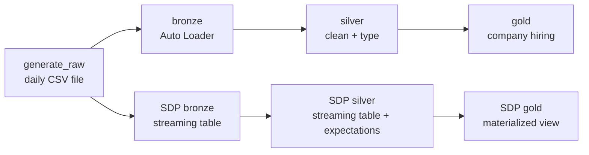
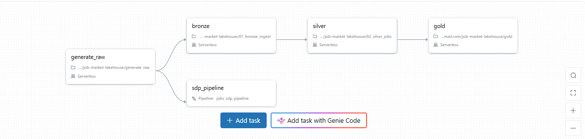
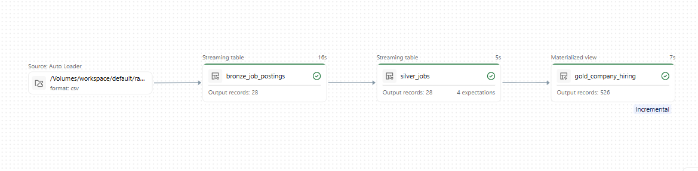
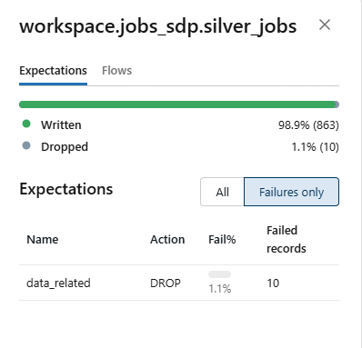

# Job Market Lakehouse on Databricks

An automated, incremental data pipeline that turns daily job-posting files into an analytics-ready view of **which companies are hiring for data roles** — built on Databricks using the medallion (bronze → silver → gold) architecture.

The same pipeline is implemented two ways — with **LakeFlow Jobs + notebooks** and with **Spark Declarative Pipelines (SDP)** — to compare an imperative and a declarative approach on the same data.

## Architecture



One LakeFlow Job (`medallion_daily`) runs every morning at 5 AM Eastern: it generates the day's file, then runs both branches in parallel.

## Screenshots

**Daily orchestration — LakeFlow Job with 5 tasks**



**Spark Declarative Pipeline — incremental run (only the new day's 28 rows processed)**



**Data-quality expectations — 10 non-data postings dropped out of 873**



## Tech stack

Databricks (serverless) · Delta Lake · Auto Loader · LakeFlow Jobs · Spark Declarative Pipelines · Unity Catalog · PySpark · Spark SQL

## Highlights

- **Incremental, idempotent ingestion** — Auto Loader loads only new files; checkpoints guarantee each file is processed exactly once, so retries and re-runs never create duplicates.
- **Parameterized backfills** — a `run_date` job parameter lets any past day be reprocessed on demand.
- **Production reliability** — task dependencies, retries, timeouts, failure email alerts, and repair runs (re-run only the failed task and what follows).
- **Data-quality expectations** — rules that drop invalid rows and track pass/fail metrics on every run.
- **Incremental gold layer** — the gold materialized view refreshes incrementally instead of recomputing everything.
- **Governance** — tables organized in Unity Catalog (`catalog.schema.table`) with least-privilege access.

## Data-quality story

A rule to keep only data-related job titles was first deployed in **warn mode**. It flagged **159 of 873 rows** — but inspection showed most were genuine *Business Intelligence* roles the pattern missed. After refining the rule (including telling "BI" = Business Intelligence apart from "Bi-lingual" and insurance "BI/UM"), only **10 rows** remained — all genuinely non-data jobs — and the rule was switched to **drop**. Lesson: observe before you delete.

## Repository structure

```
notebooks/
  generate_raw        # creates the daily input file (synthetic, see below)
  01_bronze_ingest    # Auto Loader → bronze Delta table
  02_silver_jobs      # cleaning and typing
  gold                # company hiring summary
pipeline/transformations/
  01_bronze.sql       # SDP streaming table (read_files)
  02_silver.sql       # SDP streaming table with expectations
  03_gold.sql         # SDP materialized view
```

## About the data

The seed file contains real job postings collected by my job-search agent and exported from a Neo4j job-market graph. To simulate a daily feed, `generate_raw` creates one new file per day by sampling real postings and randomizing job IDs, locations, and URLs — so company names and titles are real, but daily volumes are synthetic.
